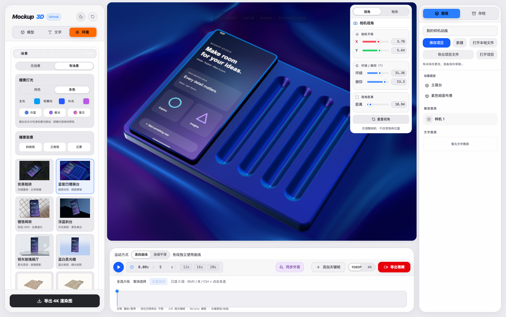
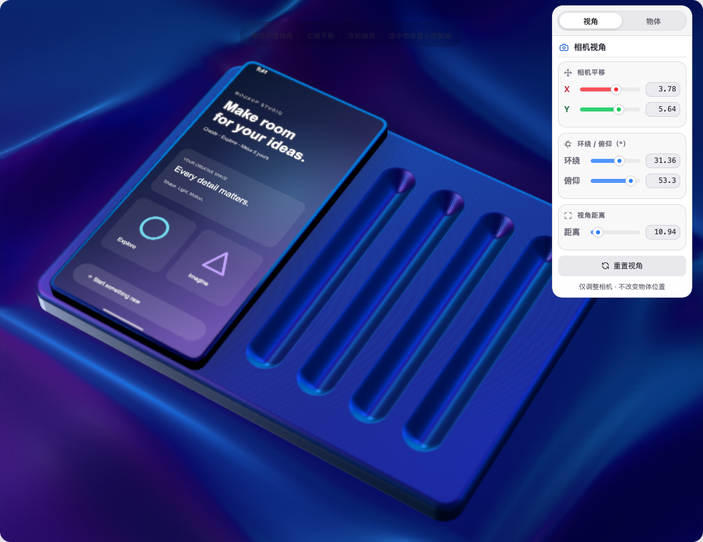
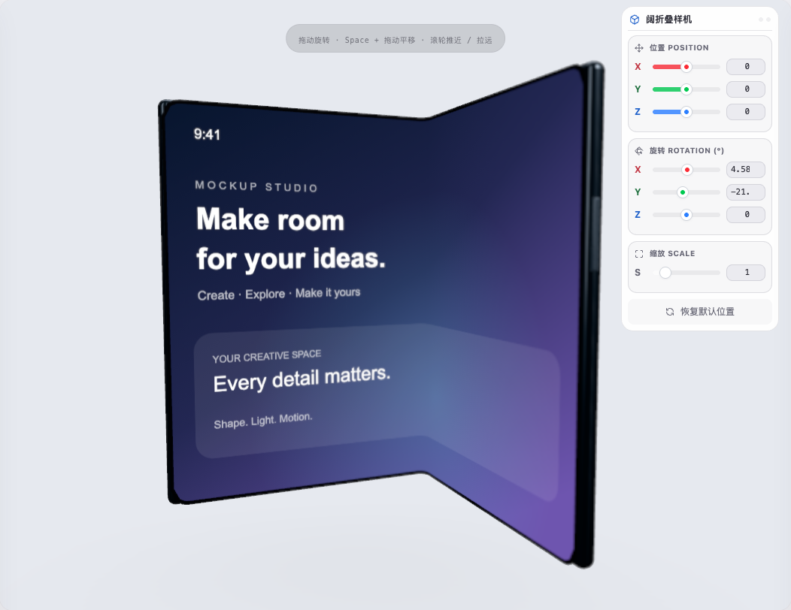
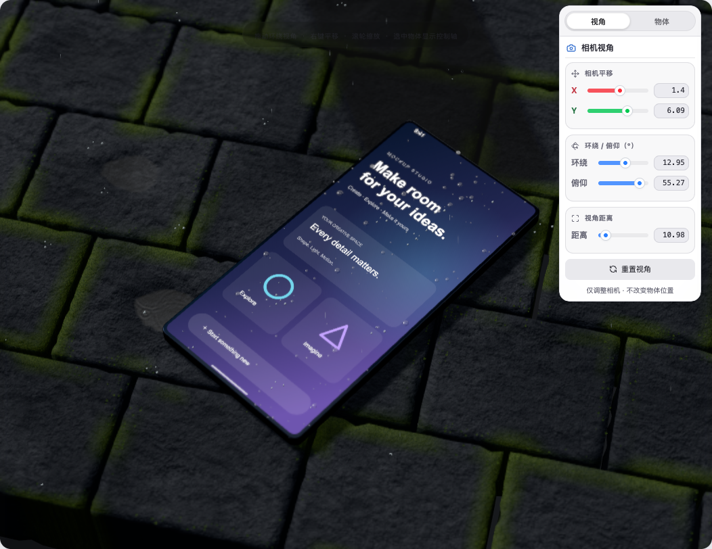

# Mockup Studio · 3D 样机大师

中文 3D 手机样机与动画编辑器。在浏览器里摆放手机、导入录屏、布置场景，再导出图片或视频。

**[直接打开在线编辑器](https://lele666999.github.io/MockupStudio/)** · [使用说明](#开始使用) · [MIT 开源许可](LICENSE)



## 能做什么

- 自制直板 / 折叠样机，0–180° 开合、独立内外屏；导入 GLB / FBX / STL，并点击选择屏幕。
- 多模型、图层、单选 / 多选变换，分别控制手机和展台。
- 屏幕图片 / 视频，以及纯色、透明、图片、视频背景；所有视频跟随时间轴，结束后停在末帧。
- 极简摄影棚、彩色压纹展台、镀铬网架、针织 / 毛绒 / 石材、粗砖雨景等可编辑场景。
- 光照、材质、相机投影、镜头景深、画幅比例与文字。
- 关键帧、逐段贝塞尔曲线 / 连续平滑运动、可编辑时长。
- 4K PNG、视频导出与取消；视频编码能力取决于浏览器 / 设备。
- 自动本地草稿、Ctrl+S / ⌘S、完整 `.mockup3d` 项目导入导出。

### 场景截图

以下均为本编辑器实时渲染截图，自制屏幕内容与自制样机，非预渲染宣传图。





## 开始使用

1. 打开 [在线编辑器](https://lele666999.github.io/MockupStudio/)，无需账号、API Key 或本地服务器。
2. 「模型 → 简单」选择直板 / 阔折叠，或「高级」选择华为 / 苹果机型、导入自己的 GLB / FBX / STL。预设机型会自动映射屏幕，其他模型需点「选择屏幕」再点击屏幕面。
3. 导入屏幕图片 / 录屏；折叠样机可另外导入外屏素材。
4. 在「环境 → 场景」选择展台和材质。拖动环绕视角、右键平移、滚轮缩放；选择手机或展台后用控制轴编辑对象。
5. 设置总时长并添加关键帧；空格播放 / 暂停，J / K 跳帧。按住空格拖动为平移。
6. 导出图片 / 视频，或在「存档」中保存完整项目文件。

### 保存与隐私

在线版是 GitHub Pages 静态网页，没有素材上传、账号系统或项目云同步接口。你导入的模型和视频在浏览器里处理，不会因为保存而上传到 GitHub。

- 自动草稿与 Ctrl+S 保存到**当前浏览器、当前网址**的 IndexedDB；同一项目覆盖更新。
- 「导出项目文件」生成包含模型、图片、视频、镜头、场景和关键帧的 `.mockup3d` 文件，供迁移 / 备份。
- 本地旧网页和在线网址的浏览器存储不互通。迁移时先在旧网页导出项目，再在在线版「打开项目」。
- 清理浏览器数据、无痕模式、切换设备或存储配额不足可能影响草稿，重要项目请另存文件。
- GitHub Pages 托管编辑器程序，不托管个人动画项目；它也不能自动写入你电脑原来的 `saved-projects` 目录。

### 模型许可范围

**公开版不捆绑未确认再分发授权的 Apple AR / 商业下载手机模型。** 你自己的本地版本与模型库不受影响，可把合法取得的模型导入编辑器。已内嵌素材的旧项目也可本地打开，使用中仍须遵守素材原许可。

高级库保留原来的 **10 款机型入口**，分为华为和苹果。Mate 70 Pro / Pura X 的自制示意模型直接内置；其余入口标明「点击导入原文件」。在「高级 → 导入本地模型库」选择原项目的 `public` 文件夹（或只含原模型的文件夹），即可按文件名批量匹配 8 款模型。也可点击单款机型导入对应原文件。

导入的库保存在当前网址、当前浏览器的 IndexedDB 中，刷新、新建项目、切换简单 / 高级后仍可选用；保留原屏幕映射、换色与 Duo 折叠适配。文件不会上传 GitHub，也不会成为公开仓库的 MIT 素材。清理浏览器数据、换设备后需要重新导入；项目仍可用完整 `.mockup3d` 文件迁移。

公开版包含参数化直板 / 折叠样机及两款自制近似外形，它们不是厂商官方高精度 CAD。
原始源码、材质算法与场景功能已保留。具体见 [MODEL_SOURCES.md](MODEL_SOURCES.md) 和 [THIRD_PARTY_NOTICES.md](THIRD_PARTY_NOTICES.md)。

## 本地开发

需要 Node.js 22.6+。推荐桌面版 Chrome / Edge，需 WebGL 2；大模型、雨景与景深比较占用 GPU。手机可访问，但完整编辑推荐电脑 / 大屏。

```sh
npm ci
npm run dev
```

```sh
npm test
npm run lint
npm run build:web
npm run preview
```

`npm run build:web` 输出可托管的 `dist/`；`npm run build` 另外生成无需服务器的 `offline/index.html`。
公开离线包使用随仓库提供的 OFL 中文字体，不复制系统字体。

`npm run check:site -- https://lele666999.github.io/MockupStudio/` 使用已安装的 Chrome 验证线上页面、场景资源、草稿、模型导入和导出。
两个依赖私人模型文件的测试在公开仓库中明确跳过；几何算法、媒体、存档、曲线、雨水、材质等其余测试照常运行。

若本机持有完整的 8 款原模型文件，还可运行 `node scripts/check-model-library.mjs /path/to/model-folder` 验证批量导入、实际网格与屏幕匹配、换色、折叠、存储失败保护、刷新 / 新建后的模型库以及完整项目导出。可在命令最后追加线上网址测试已部署版本；私人文件不写入仓库。

## GitHub Pages 部署

仓库 Settings → Pages → Source 选择 **GitHub Actions**。推送到 `main` 后，工作流自动安装依赖、检查类型、运行测试、构建 `dist/` 并部署。

遵循 [GitHub 官方 Pages 工作流](https://docs.github.com/en/pages/getting-started-with-github-pages/using-custom-workflows-with-github-pages) 与 [Vite 静态部署说明](https://vite.dev/guide/static-deploy)。资源路径兼容仓库子目录，无需服务器端 API。

Fork 后修改 README 在线网址与编辑器左上角 GitHub 链接，再启用自己仓库的 Pages。

## 技术与许可

React · TypeScript · Vite · Three.js · React Three Fiber · Drei · WebCodecs / MediaRecorder。

项目自有源码使用 **MIT License**。Poly Haven 的 HDR / PBR 素材使用 CC0；Noto Sans SC 使用 SIL OFL 1.1；第三方依赖保留各自许可证。品牌名称仅用于兼容识别，不代表官方合作或背书。
